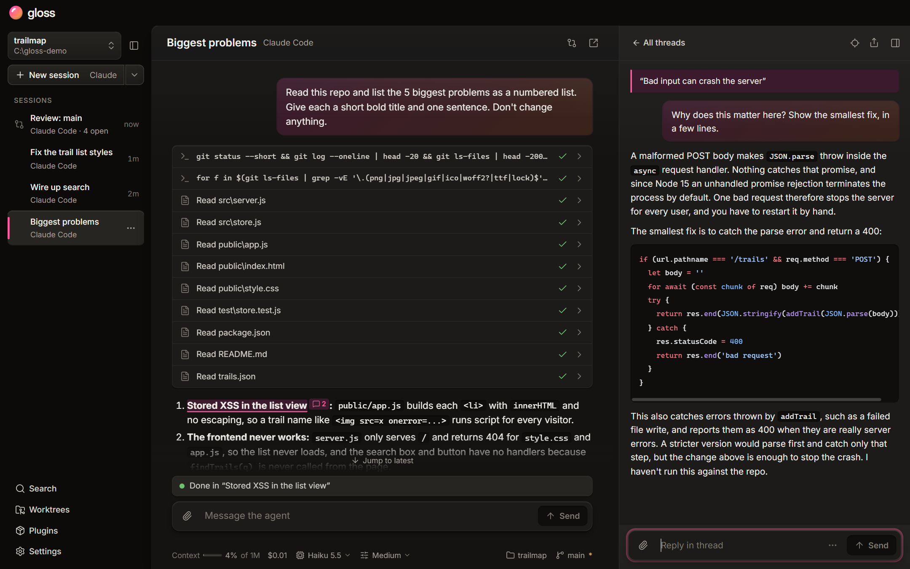
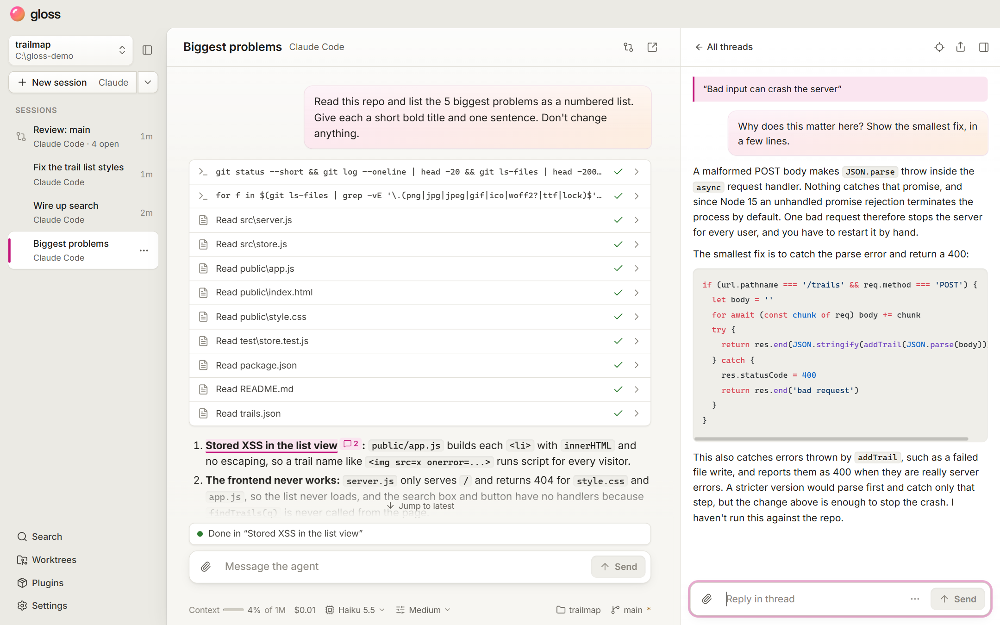

<div align="center">


# Gloss

**Reply to any point in your coding agent's answer.**

A desktop GUI for Claude Code, Codex and other [ACP](https://agentclientprotocol.com) agents, with threads.

[**Download the latest release**](https://github.com/2020wmarvil/gloss/releases/latest) · Windows, macOS, Linux · MIT

</div>



## Why threads

An agent gives you five findings. You ask about the first, and its answer pushes the other four out of view. By the time you get back to the third, you're scrolling to find it and retyping what it said.

In Gloss you select the third finding and reply to it. The discussion opens beside the conversation, your place stays put, and the other findings wait where you left them.

Threads live in the view. To the agent it's still one ordinary session that knows everything said in every thread, so you can pick it up in the agent's own CLI whenever you like. (*G*raphical *L*ayer *O*ver *S*hell *S*essions. Goodbye, Long Off-topic Scrolling Sessions.)

<video src="https://github.com/user-attachments/assets/d124dda2-f862-4db9-81dd-cc54dfd42e86" controls width="100%"></video>

## Core features

**Reply to the exact point.** Select any text in an answer and reply. The agent is told what you're referring to.


**Steer a running turn.** Send a correction while the agent works, and it picks it up without stopping.


**Point at what's wrong.** Mark up a screenshot with numbered pins, send it, and discuss each pin in its own thread.


## Also in Gloss

- **Review sessions:** read a diff, with threads on its lines and findings from the agent.
- **Worktrees:** run sessions side by side, each on its own branch.
- **Fork threads and rewind:** try something in a fork of the session, or go back to an earlier message.
- **Your phone:** drive your sessions from a phone over Tailscale.
- **Plugins:** one library of skills, subagents, hooks and MCP servers for all your agents.
- **Git and Perforce:** reviews work with both.
- **Search** across conversations, threads and tool output.

Gloss follows your system theme, or you can choose light or dark in Settings.



## Install

Download the installer from the [latest release](https://github.com/2020wmarvil/gloss/releases/latest):

- **Windows:** `Gloss-Setup-<version>.exe`
- **macOS:** the `.dmg` (Apple silicon)
- **Linux:** the `.AppImage`

Releases are unsigned, so Windows shows a SmartScreen warning on first install, and macOS needs the app allowed in System Settings. Windows and Linux copies update themselves.

Gloss runs the coding agents you already have. Install at least one and sign in to it once:

- **Claude Code** 2.1.233 or newer
- **Codex** 0.160.1 or newer
- **OpenCode** v2
- **Any other ACP agent**, added in Settings > Agents

## Development

```sh
npm install
npm run dev
```

The design is in [docs/SPEC.md](docs/SPEC.md). The visuals on this page are generated: see [marketing/README.md](marketing/README.md).

### Cutting a release

Bump the version in a pull request, then tag `main` once it's merged:

```sh
npm version 1.2.3 --no-git-tag-version   # on a branch; open a PR and merge it
git checkout main && git pull
git tag v1.2.3 && git push origin v1.2.3
```
