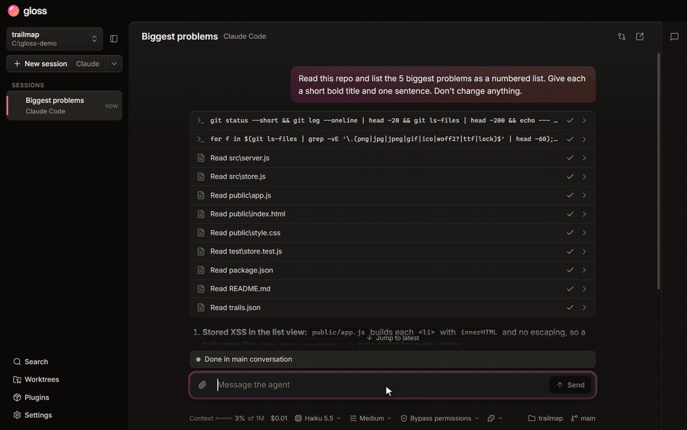
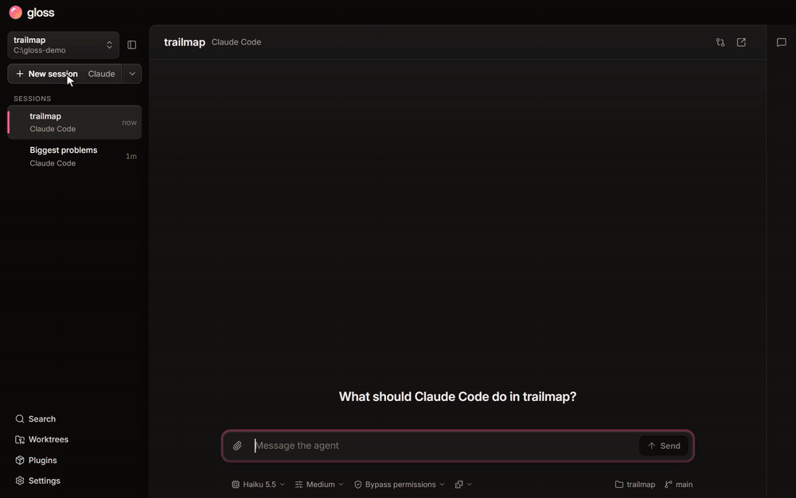
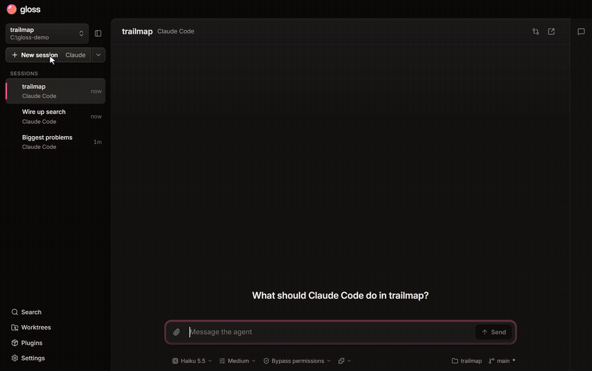

<div align="center">

<h1> Gloss</h1>

**Reply to any point in your coding agent's answer.**

*Graphical Layer Over Shell Sessions. Goodbye, Long Off-topic Scrolling Sessions.*

A desktop GUI for Claude Code, Codex and other [ACP](https://agentclientprotocol.com) agents, with threads.

[**Download the latest release**](https://github.com/2020wmarvil/gloss/releases/latest) · Windows, macOS, Linux · MIT

</div>

https://github.com/user-attachments/assets/e380e565-b342-4c02-944e-17f0f5edee1f

## Core features

**Reply to the exact point.** Select any text in an answer and reply. The agent is told what you're referring to.



**Redirect the agent mid-task.** Send a correction while it works, and it picks it up without stopping.



**Point at what's wrong.** Mark up a screenshot with numbered pins, send it, and discuss each pin in its own thread.



## Also in Gloss

- **Review sessions:** read a diff, with threads on its lines and findings from the agent.
- **Worktrees:** run sessions side by side, each on its own branch.
- **Fork threads and rewind:** try something in a fork of the session, or go back to an earlier message.
- **Your phone:** drive your sessions from a phone over Tailscale.
- **Plugins:** one library of skills, subagents, hooks and MCP servers for all your agents.
- **Git and Perforce:** reviews work with both.
- **Search** across conversations, threads and tool output.

## Install

Download the installer from the [latest release](https://github.com/2020wmarvil/gloss/releases/latest):

- **Windows:** `Gloss-Setup-<version>.exe`
- **macOS:** the `.dmg` (Apple silicon)
- **Linux:** the `.AppImage`

Gloss runs the coding agents you already have:

- **Claude Code** 2.1.233 or newer
- **Codex** 0.160.1 or newer
- **OpenCode** v2
- **Any other ACP agent**

## Development

```sh
npm install
npm run dev
```

### Cutting a release

Bump the version in a pull request, then tag `main` once it's merged:

```sh
npm version 1.2.3 --no-git-tag-version   # on a branch; open a PR and merge it
git checkout main && git pull
git tag v1.2.3 && git push origin v1.2.3
```
